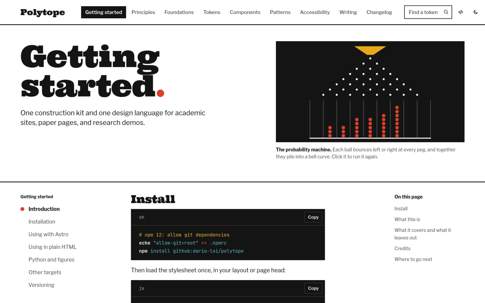
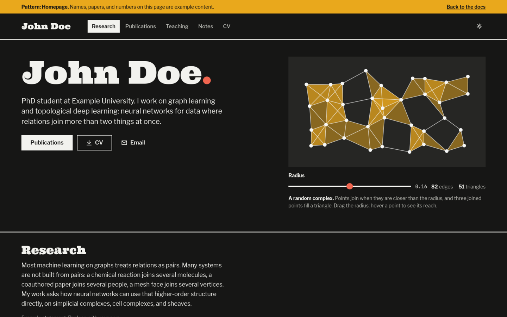

# Polytope

Polytope is a design system for researchers who publish on the web: a personal academic site, a page for each paper, and the small interactive demos that go with them. It ships as plain CSS, Astro components, and a Python theme, all compiled from one token file, so the figures in a paper match the page that hosts them.



Documentation and live examples: https://dario-loi.github.io/polytope/

## What it looks like

The visual language borrows from the mathematics exhibition Charles and Ray Eames designed for IBM in 1961. Pages are white walls with black exhibit panels and heavy rules. Titles are set in Ultra, a fat wood-type slab. Everything you read is in Libre Franklin, and code is in JetBrains Mono. Red marks the one thing that moves or the place you are, mustard holds notes, and teal is for links.

Each page gets one working model. The docs open with a probability machine, a Galton board that drops real random balls into a bell curve. The homepage pattern uses a random simplicial complex that grows edges and triangles as you drag a radius. Both work without JavaScript and settle into their final state when the reader asks for reduced motion.



## What's included

- About 30 CSS components, from buttons and forms to paper headers, citations, theorem environments, a publication list, and demo chrome. Light and dark themes switch on their own.
- 32 Astro components that print the same markup.
- The two working models as custom elements, `<ply-machine>` and `<ply-complex>`.
- A chart palette of eight colors, checked for color vision deficiency in both themes, with matplotlib, plotly, Gradio, and Streamlit themes that use it.
- Exports for Tailwind v4, Sass, LaTeX (xcolor and a pgfplots cycle list), TypeScript, Figma token plugins, and a code theme for Shiki and VS Code.
- The documentation site itself, with three full example pages: a homepage, a paper page, and a demo.

## Install

npm 12 refuses git dependencies unless a project opts in, so add one line to your project's `.npmrc` first:

```sh
echo "allow-git=root" >> .npmrc
npm install github:dario-loi/polytope
```

Then import the stylesheet once in your layout:

```js
import "@dario-loi/polytope/css";
```

A page without a build step can link the hosted files:

```html
<link rel="stylesheet" href="https://dario-loi.github.io/polytope/kit/polytope.css">
<script type="module" src="https://dario-loi.github.io/polytope/kit/js/all.js"></script>
```

The Python theme installs from the `python/` folder of this repository:

```sh
pip install "polytope-theme[matplotlib,plotly] @ git+https://github.com/dario-loi/polytope#subdirectory=python"
```

## A first page

With Astro:

```astro
---
import "@dario-loi/polytope/css";
import { TopBar, Mast, Machine, Note } from "@dario-loi/polytope/astro";
---
<TopBar brand="John Doe" links={[{ label: "Research", href: "/" }]} />
<Mast title="Research" lede="Graph learning and the shapes data comes in.">
  <Machine slot="exhibit" interactive />
</Mast>
<main class="ply-container ply-prose">
  <Note>Results are averaged over five seeds.</Note>
</main>
```

With matplotlib, so the figures in the paper match the page:

```python
import matplotlib.pyplot as plt
import polytope_theme as ply

ply.use("light")
fig, ax = plt.subplots()
ax.plot(epochs, accuracy, label="GCN")
fig.savefig("figure.pdf")
```

## Working on Polytope

```sh
git clone https://github.com/dario-loi/polytope
cd polytope
npm install              # installs dependencies and builds dist/
npm run docs:dev         # rebuilds the kit and serves the docs locally
npm run check:contrast   # fails if any text pair drops below WCAG AA
npm run check:prose      # fails on any en or em dash in the sources or the built docs
cd python && pytest      # tests for the Python theme
```

Design decisions live in `tokens/tokens.json` and styles in `css/src/`. The build writes everything else, including `dist/` and the generated Python files, so edit the sources and run `npm run build`. `DESIGN.md` records the system as built and the rules behind it.

| Path | What it holds |
|---|---|
| `tokens/tokens.json` | Every design decision, in the W3C Design Tokens format |
| `css/src/` | The CSS core, in cascade layers, with the `ply-` prefix |
| `css/js/` | The working models and small scripts for copy buttons, the theme toggle, and form controls |
| `astro/` | Astro components |
| `python/` | The `polytope-theme` package |
| `scripts/` | The build and the contrast and prose checks, using only Node's standard library |
| `docs/` | The documentation site |

## Status

This is version 0.1. The core components are marked stable in the docs; the working models, research components, and demo chrome are experimental and may change before 1.0. The changelog on the docs site lists what changes between releases.

## Credits and license

Polytope is made by Dario Loi at Northeastern University and released under the Apache License 2.0. See `LICENSE` and `NOTICE`.

The bundled fonts keep their own licenses, shipped next to the font files: Ultra by Astigmatic under the Apache License 2.0, and Libre Franklin and JetBrains Mono under the SIL Open Font License 1.1. The definition of a design system that the docs follow comes from the [SBB design system](https://digital.sbb.ch/en/design-system/getting-started/intro/).
