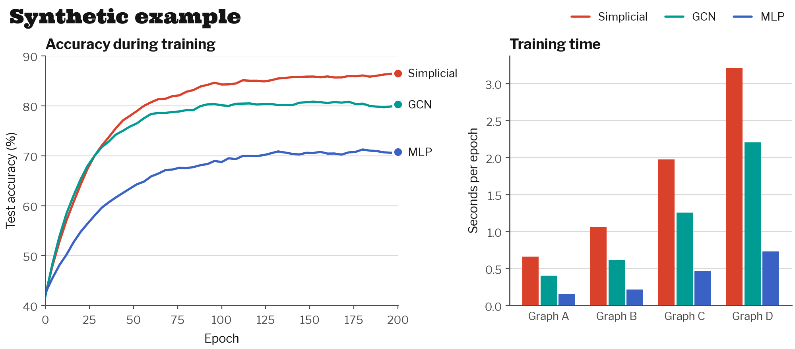
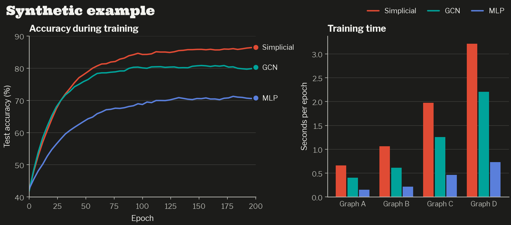

# polytope-theme

Chart and app themes for the Polytope design system, covering matplotlib, plotly, gradio and streamlit. Colors and fonts come from `tokens/tokens.json` at the repository root, and `scripts/build.mjs` writes them into this package.



## Install

```sh
pip install "git+https://github.com/dario-loi/polytope#subdirectory=python"
```

The package has no required dependencies. Each integration has an extra that pulls in its library: `matplotlib`, `plotly`, `gradio`, `streamlit`, or `all`.

```sh
pip install "polytope-theme[matplotlib,plotly] @ git+https://github.com/dario-loi/polytope#subdirectory=python"
```

## Palette

```python
import polytope_theme as ply

ply.colors("light")["accent"]   # "#D9412B"
ply.categorical("dark", n=3)    # first three series colors for dark mode
ply.SEQUENTIAL                  # cobalt ramp, light to dark
ply.DIVERGING                   # cobalt, gray midpoint, tomato
ply.STATUS                      # good, warning, serious, critical
ply.SURFACE, ply.FONTS
```

Series get categorical colors in a fixed order, and the colors never repeat. `categorical()` raises `ValueError` for more than 8 series; fold the extra series into an "Other" group or split the chart into small multiples. Scatter plots and small multiples use only the first 3 slots (`ply.SCATTER_SLOTS`). Use `SEQUENTIAL` for magnitudes and `DIVERGING` for values around a meaningful center. The four `STATUS` colors are reserved for states and always appear next to a label or marker.

## matplotlib

```python
import matplotlib.pyplot as plt
import polytope_theme as ply
from polytope_theme.mpl import label_lines

ply.use("light")  # or "dark"

fig, ax = plt.subplots()
for name, ys in runs.items():
    ax.plot(epochs, ys, label=name)
ax.legend()
label_lines(ax)  # writes each series name at the right end of its line
```

`label_lines` uses the text color for labels, spreads labels that would overlap, and draws a thin leader line for any label it had to move.

`ply.use()` also registers the colormaps `ply-sequential` and `ply-diverging`, with `_r` reversed versions, and makes `ply-sequential` the default for images.

```python
from matplotlib.colors import TwoSlopeNorm

ax.imshow(delta, cmap="ply-diverging", norm=TwoSlopeNorm(vcenter=0))
```

To apply the style to one block of code, use `plt.rc_context(polytope_theme.mpl.rc_params("dark"))`.

matplotlib only finds Libre Franklin if it is installed as a system font (TTF or OTF from Google Fonts). Without it, text falls back to Franklin Gothic, Helvetica Neue, Arial and then DejaVu Sans.

`examples/make_examples.py` renders the figures in this README. The dark version:



## plotly

```python
import plotly.express as px
from polytope_theme import plotly_theme

plotly_theme.register(default="light")  # adds "polytope" and "polytope_dark"

fig = px.line(df, x="epoch", y="accuracy", color="model")
fig.update_layout(template="polytope_dark")  # override for one figure
```

`plotly_theme.template(mode)` returns the `Template` object directly if you would rather leave `plotly.io.templates` alone.

## gradio

```python
import gradio as gr
from polytope_theme.gradio_theme import theme

with gr.Blocks() as demo:
    gr.Textbox(label="Graph ID")
    gr.Button("Run", variant="primary")

demo.launch(theme=theme("light"))
```

Gradio 6 takes the theme in `launch()`. On gradio 4 and 5, pass it as `gr.Blocks(theme=theme())`. The mode can be "light", "dark", or "auto", which follows the browser setting. Corners are square, primary buttons are black and turn tomato on hover, and fonts load from Google Fonts.

## streamlit

```python
from polytope_theme.streamlit_theme import config_toml, write_config

write_config(".streamlit/config.toml", mode="light")
print(config_toml("dark"))
```

Run `write_config` once from the app folder. It will not replace a `config.toml` that it did not write itself; pass `overwrite=True`, or paste the output of `config_toml()` into your existing file. The font settings need streamlit 1.50 or newer. For older versions or offline apps, use `config_toml(mode, google_fonts=False)`.

## Development

```sh
uv venv .venv
uv pip install --python .venv/bin/python -e ".[matplotlib,plotly]" pytest
.venv/bin/python -m pytest
```

`src/polytope_theme/_tokens.py` and the files in `src/polytope_theme/styles/` are generated. To change them, edit `tokens/tokens.json` at the repository root and run `node scripts/build.mjs`.
